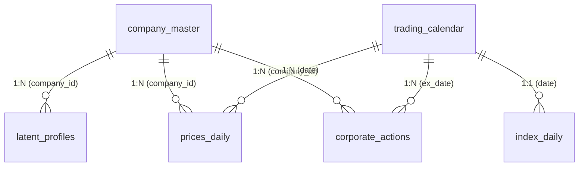

# SIRPS — Member 2 Data Dictionary & Dataset Contracts
**Module / Workstream**: Member 2 — Market & Trading Data / Company Explorer  
**System**: Sustainable Investment Return Prediction System (SIRPS)  
**Lifecycle Tier**: `PRODUCTION_GENERATED`  
**Master Random Seed**: 42 (`SEED_STREAMS['calendar']=45`, `SEED_STREAMS['index']=46`, `SEED_STREAMS['prices']=47`, `corporate_actions=97`)  
**Data Provenance**: `SYNTHETIC_DEMO`  

---

## 1. Disclaimers & Synthetic Research Scope
1. **Fictional Sustainable Equities**: All 10 companies (`C01` through `C10`) are purely fictional green entities designed for econometric methodology demonstration. They do not represent real listed companies on the National Stock Exchange of India (NSE) or any other exchange.
2. **Stylized Synthetic Benchmark**: The NIFTY 50 and NIFTY TRI series are generated via a regime-switching Geometric Brownian Motion calibrated to historical macro trends (COVID crash, post-COVID bull, 2022 tightening, 2024-25 correction). They are not empirical NSE Bhavcopy observations.
3. **Synthetic Volatility Proxy (India VIX)**: The synthetic India VIX series is modeled via an Ornstein-Uhlenbeck stochastic volatility process with exact negative leverage shock correlation ($\rho_{\text{lev}} = -0.35$). It serves as a volatility proxy, not an options-implied empirical volatility index.
4. **Simulation Timeline & Warm-Up Window**:
   - The simulation spans 6 calendar years: **2020-01-01 through 2025-12-31** (1,526 trading sessions).
   - **2020 is designated as a warm-up year** for factor burn-in, trailing momentum calculation, and availability lag initialization.
   - **2021–2025 is the formal predictive modeling and research evaluation period**.
5. **Prediction Horizon**: The 63-trading-day forward prediction horizon (~1 quarter) is a downstream feature engineering convention and not a guarantee of investment returns.

---

## 2. Dataset Specifications

### 2.1 `company_master.csv`
- **File Location**: `data/company_master.csv`
- **Owner**: Member 1 (Project Lead & Integrator)
- **Purpose**: Canonical registry of the 10 fictional green companies, sector classifications, business models, and starting baseline parameters.
- **Row Count**: Exactly **10 rows**.
- **Primary Key**: `company_id`
- **Foreign Keys**: None (Root parent entity table).
- **Generator Script**: `data_generation/company_master.py`

| Column | Data Type | Nullable | Units / Format | Description |
|:---|:---|:---:|:---|:---|
| `company_id` | string | No | `C01`–`C10` | Unique company identifier |
| `company_name` | string | No | Text | Fictional company legal name |
| `ticker` | string | No | Uppercase string | Synthetic trading ticker symbol |
| `sector` | string | No | Sector name | One of 5 green sectors |
| `sub_sector` | string | No | Sub-sector name | Industrial specialization |
| `universe_group` | string | No | `core` | Universe membership group |
| `listing_date` | string | No | `YYYY-MM-DD` | Synthetic exchange listing date |
| `base_price` | float64 | No | INR (₹) | Initial share price at 2020-01-01 (range: ₹185.00 to ₹780.00) |
| `is_synthetic` | bool | No | `True` | Flag indicating synthetic demonstration data |
| `business_model` | string | No | Text | Description of core business and revenue generation |
| `capital_intensity` | string | No | Archetype level | Level of capital intensity (`High`, `Medium-High`, etc.) |
| `growth_profile` | string | No | Archetype level | Target structural growth trajectory |
| `revenue_stability` | string | No | Archetype level | Customer revenue predictability |
| `technology_dependence` | string | No | Archetype level | Dependence on proprietary technology and IP |
| `business_risk_type` | string | No | Text | Primary operational or market risk exposure |
| `profile_version` | string | No | `v1.0` | Archetype version identifier |
| `data_source` | string | No | `SYNTHETIC_DEMO` | Provenance audit tag |

---

### 2.2 `latent_profiles.csv`
- **File Location**: `data/latent_profiles.csv`
- **Owner**: Member 1 (Project Lead & Integrator)
- **Purpose**: Annual correlated latent factors ($\text{ESG}, \text{Quality}, \text{Risk}, \text{Growth}$) and mapping to econometric asset pricing parameters ($\beta_{i,y}, \sigma_{i,y}^{\text{idio}}, \alpha_{i,y}$).
- **Row Count**: Exactly **60 rows** (10 companies $\times$ 6 years).
- **Primary Key**: `["company_id", "fiscal_year"]`
- **Foreign Keys**: `company_id` $\to$ `company_master.company_id`
- **Generator Script**: `data_generation/latent.py`

| Column | Data Type | Nullable | Units / Format | Description |
|:---|:---|:---:|:---|:---|
| `company_id` | string | No | `C01`–`C10` | References company master |
| `fiscal_year` | string | No | `FY2020-21`–`FY2025-26` | Indian fiscal year identifier |
| `year` | int64 | No | `2020`–`2025` | Calendar year index |
| `esg_latent_score` | float64 | No | Z-score / Index | Underlying true ESG capability profile |
| `quality_latent_score` | float64 | No | Z-score / Index | Underlying operational quality profile |
| `risk_latent_score` | float64 | No | Z-score / Index | Underlying business risk profile |
| `growth_latent_score` | float64 | No | Z-score / Index | Underlying revenue growth profile |
| `beta` | float64 | No | Ratio (dimensionless) | Annual market sensitivity coefficient ($\beta_{i,y}$) |
| `idio_volatility` | float64 | No | Annualized % / 100 | Annual idiosyncratic volatility ($\sigma_{i,y}^{\text{idio}}$) |
| `base_drift` | float64 | No | Annualized % / 100 | Annual base expected alpha / return ($\alpha_{i,y}$) |
| `profile_version` | string | No | `v1.0` | Profile specification version |
| `data_source` | string | No | `SYNTHETIC_DEMO` | Provenance audit tag |

---

### 2.3 `trading_calendar.csv`
- **File Location**: `data/trading_calendar.csv`
- **Owner**: Member 2 (Market & Trading Data)
- **Purpose**: Canonical exchange trading calendar for 2020–2025. Excludes all weekends and Indian holidays. Identifies exact monthly rebalancing dates.
- **Row Count**: Exactly **1,526 rows** (matching expected 254–255 trading days/year).
- **Primary Key**: `date`
- **Foreign Keys**: None (Root calendar reference table).
- **Generator Script**: `data_generation/gen_calendar.py`

| Column | Data Type | Nullable | Units / Format | Description |
|:---|:---|:---:|:---|:---|
| `date` | string | No | `YYYY-MM-DD` | Unique exchange trading session date |
| `trading_day_index` | int64 | No | `0`–`1525` | Sequential 0-based trading session integer |
| `year` | int64 | No | `2020`–`2025` | Calendar year |
| `is_month_end` | bool | No | `True` / `False` | Identifies last trading session of calendar month (exactly 72 month-ends) |
| `data_source` | string | No | `SYNTHETIC_DEMO` | Provenance audit tag |

---

### 2.4 `index_daily.csv`
- **File Location**: `data/index_daily.csv`
- **Owner**: Member 2 (Market & Trading Data)
- **Purpose**: Daily synthetic NIFTY 50 price benchmark, NIFTY Total Return Index (TRI), and India VIX volatility benchmark.
- **Row Count**: Exactly **1,526 rows** (1-to-1 match with `trading_calendar.csv`).
- **Primary Key**: `date`
- **Foreign Keys**: `date` $\to$ `trading_calendar.date`
- **Generator Script**: `data_generation/gen_index.py`

| Column | Data Type | Nullable | Units / Format | Description |
|:---|:---|:---:|:---|:---|
| `date` | string | No | `YYYY-MM-DD` | References trading calendar date |
| `nifty_close` | float64 | No | Index Points | NIFTY 50 price index level ($I_0 = 12,000.00$) |
| `nifty_tri` | float64 | No | Index Points | NIFTY Total Return Index including 1.30% continuous dividend reinvestment ($I_t^{\text{TRI}} \ge I_t$) |
| `india_vix` | float64 | No | Annualized Vol (%) | Continuous log-OU volatility benchmark with $\kappa=0.08, \rho_{\text{lev}}=-0.35$ |
| `data_source` | string | No | `SYNTHETIC_DEMO` | Provenance audit tag |

---

### 2.5 `prices_daily.csv`
- **File Location**: `data/prices_daily.csv`
- **Owner**: Member 2 (Market & Trading Data)
- **Purpose**: Daily OHLCV and total-return adjusted close for all 10 companies across the full 6-year history. Incorporates multi-factor market, sector, and idiosyncratic returns, planted weak signals, and split adjustments.
- **Row Count**: Exactly **15,260 rows** (10 companies $\times$ 1,526 sessions).
- **Primary Key**: `["company_id", "date"]`
- **Foreign Keys**:
  - `company_id` $\to$ `company_master.company_id`
  - `date` $\to$ `trading_calendar.date`
- **Generator Script**: `data_generation/gen_prices.py`

| Column | Data Type | Nullable | Units / Format | Description |
|:---|:---|:---:|:---|:---|
| `company_id` | string | No | `C01`–`C10` | References company master |
| `date` | string | No | `YYYY-MM-DD` | References trading calendar date |
| `open` | float64 | No | INR (₹) | Session opening price (centered on split-adjusted previous close with overnight gap) |
| `high` | float64 | No | INR (₹) | Session intraday high ($\ge \max(\text{open}, \text{close})$) |
| `low` | float64 | No | INR (₹) | Session intraday low ($\le \min(\text{open}, \text{close})$, strictly $> 0$) |
| `close` | float64 | No | INR (₹) | Session raw closing trade price ($=\operatorname{round}(\text{adj\_close} \times \text{split\_factor}, 2)$) |
| `adj_close` | float64 | No | INR (₹) | Total-return adjusted closing price (strictly continuous across splits, $0\%$ cliff) |
| `volume` | int64 | No | Number of shares | Daily traded share volume (log-normal, elastic to absolute return, split-adjusted) |
| `data_source` | string | No | `SYNTHETIC_DEMO` | Provenance audit tag |

---

### 2.6 `corporate_actions.csv`
- **File Location**: `data/corporate_actions.csv`
- **Owner**: Member 2 (Market & Trading Data)
- **Purpose**: Master record of all capital structure changes (stock splits) and cash distributions (annual dividends) across the universe.
- **Row Count**: Exactly **52 rows** (2 stock splits + 50 annual dividends).
- **Primary Key**: `action_id`
- **Foreign Keys**: `company_id` $\to$ `company_master.company_id`
- **Generator Script**: `data_generation/gen_actions.py`

| Column | Data Type | Nullable | Units / Format | Description |
|:---|:---|:---:|:---|:---|
| `action_id` | string | No | `CA001`–`CA052` | Unique corporate action identifier |
| `company_id` | string | No | `C01`–`C10` | References company master |
| `ex_date` | string | No | `YYYY-MM-DD` | Ex-entitlement trading date (validated against trading calendar) |
| `action_type` | string | No | `split` / `dividend` | Classification of corporate action |
| `ratio_or_amount` | float64 | No | Ratio or INR (₹) | Split ratio (e.g. `2.0` for 2:1 split) or cash dividend per share (₹) |
| `description` | string | No | Text | Narrative description of corporate action |
| `data_source` | string | No | `SYNTHETIC_DEMO` | Provenance audit tag |

---

## 3. Referential Integrity & Relationship Diagram

- **Referential Consistency**:
  - Every `company_id` in child tables exists in `company_master.csv`.
  - Every `date` in `prices_daily.csv` and `index_daily.csv` exists in `trading_calendar.csv`.
  - Every `ex_date` in `corporate_actions.csv` exists in `trading_calendar.csv`.
  - Primary key uniqueness is strictly satisfied on all 6 tables without duplicate keys or null entries.
