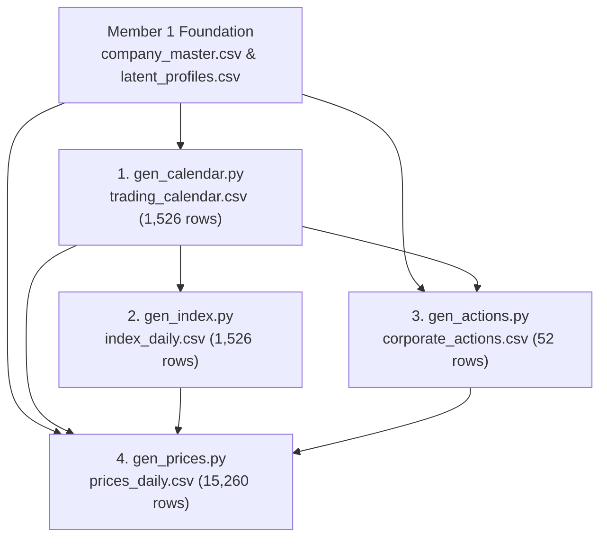

# SIRPS Member 2 Validation Protocol & Engineering Runbook

**Module:** Member 2 — Synthetic Market Data & Company Explorer  
**Document Status:** Official Protocol & Runbook  
**Version:** 1.0.0 (Member 2 Final Integration Release)  
**Foundation Baseline:** `member-1-integration`  
**Target Branch:** `member-2-integration`  
**Provenance Flag:** `SYNTHETIC_DEMO`  

---

## 1. Overview and Operational Principles

This protocol specifies standard operating procedures for executing, validating, testing, and verifying the Member 2 deliverables of the Sustainable Investment Return Prediction System (SIRPS).

Member 2 operates under four binding architectural principles:
1. **Methodological Transparency:** All market indices, volatility series, company OHLCV prices, and corporate actions are generated demonstration data tagged with `data_source = "SYNTHETIC_DEMO"`. No real-world market or ticker feeds are used.
2. **Deterministic Reproducibility:** Fixed random seeds (`MASTER_SEED = 42`) guarantee bit-for-bit identity across repeated pipeline runs.
3. **Temporal Realism & Lookahead Elimination:** Simulation strictly adheres to 2020–2025 calendar dates (1,526 trading days: 256 in 2020, 256 in 2021, 254 in 2022, 252 in 2023, 254 in 2024, 254 in 2025), treats 2020 (indices 0–255) as a warmup period, aligns annual latent profiles by calendar `year` (int64), and silences ESG factor drift until annual filing availability dates (July 15).
4. **Strict Interface Integrity:** All dataset access must use `common.io.load_dataset()` and conform to schemas registered in `common.schemas`.

---

## 2. Environment and Execution Requirements

### 2.1 Python Environment
- **Python Version:** 3.10 or 3.11 (tested on Python 3.10.9 and 3.11.9, Windows x64).
- **Core Dependencies:**
  - `pandas >= 2.0.0`
  - `numpy >= 1.24.0`
  - `scipy >= 1.10.0`
  - `streamlit >= 1.30.0`
  - `plotly >= 5.18.0`
  - `pytest >= 7.4.0`

---

## 3. Dataset Generation Pipeline & Execution Order

All Member 2 data generators reside in `data_generation/` and must be executed in strict sequential order due to upstream relational dependencies:



### 3.1 Stage-by-Stage Generation Commands

1. **Stage 1 — Trading Calendar:**
   ```powershell
   python data_generation/gen_calendar.py
   ```
   *Output:* `data/trading_calendar.csv` (1,526 trading days across 2020-01-01 to 2025-12-31).

2. **Stage 2 — Market Benchmark & VIX Proxy:**
   ```powershell
   python data_generation/gen_index.py
   ```
   *Output:* `data/index_daily.csv` (1,526 rows with NIFTY 50 close, NIFTY TRI, and India VIX).

3. **Stage 3 — Corporate Actions:**
   ```powershell
   python data_generation/gen_actions.py
   ```
   *Output:* `data/corporate_actions.csv` (52 actions: 2 stock splits on C03 and C06, 50 annual dividends across 10 companies for 2021–2025).

4. **Stage 4 — Company Daily OHLCV Prices:**
   ```powershell
   python data_generation/gen_prices.py
   ```
   *Output:* `data/prices_daily.csv` (15,260 daily OHLCV bars across 10 companies).

> [!IMPORTANT]
> The production datasets in `data/` are already generated, validated, and frozen. Do not re-run these generators unless deliberately recreating the canonical data store.

---

## 4. Production Dataset Specifications & Row Counts

| Dataset | Relative Path | Expected Rows | Primary Key | Foreign Keys | Provenance |
|---|---|---:|---|---|---|
| **Company Master** | `data/company_master.csv` | 10 | `['company_id']` | None | `SYNTHETIC_DEMO` |
| **Latent Profiles** | `data/latent_profiles.csv` | 60 | `['company_id', 'fiscal_year']` | `company_id -> company_master.company_id` | `SYNTHETIC_DEMO` |
| **Trading Calendar** | `data/trading_calendar.csv` | 1,526 | `['date']` | None | `SYNTHETIC_DEMO` |
| **Index Daily** | `data/index_daily.csv` | 1,526 | `['date']` | `date -> trading_calendar.date` | `SYNTHETIC_DEMO` |
| **Prices Daily** | `data/prices_daily.csv` | 15,260 | `['company_id', 'date']` | `company_id -> company_master.company_id`<br/>`date -> trading_calendar.date` | `SYNTHETIC_DEMO` |
| **Corporate Actions** | `data/corporate_actions.csv` | 52 | `['action_id']` | `company_id -> company_master.company_id`<br/>`ex_date -> trading_calendar.date` | `SYNTHETIC_DEMO` |

*Notes on Keys and Sessions:*
- **Latent Profiles Keys:** The schema primary key is `['company_id', 'fiscal_year']`. Columns include both `fiscal_year` (string, e.g. `'FY2020-21'`) and `year` (int64, e.g. `2020`). Downstream temporal joins with market data use `['company_id', 'year']`.
- **Trading Calendar Sessions:** Exactly 1,526 trading days across 2020–2025: 2020 (256 sessions, indices 0–255), 2021 (256 sessions, first index 256), 2022 (254 sessions), 2023 (252 sessions), 2024 (254 sessions), 2025 (254 sessions). (Do not confuse the conventional 252-day annualisation factor with actual annual session counts).

---

## 5. Mathematical & Methodological Specifications

### 5.1 Market Benchmark Index & Total Return Index (TRI)
The benchmark simulates NIFTY 50 dynamics using a regime-switching geometric jump-diffusion process:
$$R_{m, t} = \mu_{R_t} \Delta t + \sigma_{R_t} \sqrt{\Delta t} \, z_{m, t} + J_t$$
- **Regimes ($R_t$):** Bull ($\mu = +16\%$, $\sigma = 12\%$), Normal ($\mu = +10\%$, $\sigma = 15\%$), Bear ($\mu = -18\%$, $\sigma = 24\%$), High Volatility ($\mu = -5\%$, $\sigma = 30\%$), and Recovery ($\mu = +22\%$, $\sigma = 18\%$).
- **Total Return Index (TRI):** Incorporates an annual dividend reinvestment yield ($d = 1.5\%$ p.a.):
  $$\text{TRI}_t = \text{TRI}_{t-1} \cdot \frac{P_{m, t}}{P_{m, t-1}} \cdot \left(1 + \frac{d}{252}\right)$$
- Base level on 2020-01-01: $P_{m, 0} = 12,168.45$, $\text{TRI}_0 = 12,168.45$.

### 5.2 India VIX Volatility Proxy (Calibrated OU Model)
The synthetic VIX is modelled as a continuous mean-reverting Ornstein-Uhlenbeck process in log-volatility space with an empirical leverage correlation to market innovations:
$$x_t = \log(\text{VIX}_t)$$
$$\Delta x_t = \kappa (\log \bar{\theta}_{R_t} - x_{t-1}) \Delta t + \sigma_x \left(-\rho_v z_{m, t} + \sqrt{1 - \rho_v^2} \, z_{v, t}\right)$$
- **Parameters:**
  - Mean reversion speed: $\kappa = 0.08$
  - Independent volatility of log-VIX: $\sigma_x = 0.04$
  - Leverage correlation: $\rho_v = 0.35$ (negative market shock $z_{m, t} < 0$ induces positive spike in log-VIX)
  - Regime equilibrium targets $\bar{\theta}_{R_t} \in [13.0, 32.0]$
  - Bounded naturally by continuous mean reversion without artificial boundary clipping.

### 5.3 Company Price Generation & Planted Signals
Daily company log-returns follow a multi-factor specification:
$$R_{i, t} = \alpha_{i, t} \Delta t + \beta_{i, t} R_{m, t} + \gamma_s R_{s, t} + \sigma_{\epsilon, i} \sqrt{\Delta t} \, z_{i, t}$$
- **Planted Research Signals:**
  - Momentum: $\text{MOMENTUM\_SIGNAL} = 0.02$ (63-day lookback return standardized)
  - Quality: $\text{QUALITY\_SIGNAL} = 0.02$ (latent profile `quality_latent_score`)
  - ESG: $\text{ESG\_SIGNAL} = 0.04$ (latent profile `esg_latent_score`)
- **Point-in-Time ESG Availability Rule:** For calendar year $Y$, the ESG drift contribution remains exactly $0.0$ until July 15 of year $Y$, reflecting the empirical publication lag of annual sustainability/BRSR disclosures and strictly eliminating lookahead bias.

### 5.4 Corporate Actions & Split Adjustments
- **Split Events (2 historical occurrences):**
  - C03 (Jaldhara Water Tech): 2-for-1 stock split on 2022-08-11 (`ratio_or_amount = 2.0`).
  - C06 (Ampere Cell Energy): 2-for-1 stock split on 2023-04-13 (`ratio_or_amount = 2.0`).
- **Backward Adjustment Factor ($C_t$):**
  $$C_t = \prod_{s \ge t} k_s, \quad \text{where } k_s = \begin{cases} \frac{1}{\text{split ratio}} & \text{if } s = \text{ex-date} \\ 1.0 & \text{otherwise} \end{cases}$$
- **Adjusted Close:**
  $$P_{\text{adj}, t} = P_{\text{raw}, t} \cdot C_t$$
  This formulation guarantees price continuity across split boundaries without artificial visual or return crashes.
- **Cash Dividends (50 occurrences):** Exactly 5 annual dividend payments per company for calendar years 2021 through 2025 (10 companies × 5 years = 50 dividends), with cash amounts ranging from ₹2.22 to ₹7.49 per share. All records carry `data_source = "SYNTHETIC_DEMO"`. Cash dividends do not adjust the stock split multiplier.

---

## 6. Company Explorer Calculation Definitions

### 6.1 Moving Averages & Lookback Policy
- **Formula:**
  $$\text{MA}_w(t) = \frac{1}{w} \sum_{k=0}^{w-1} P_{t-k}, \quad w \in \{50, 200\}$$
- **Causality & Lookback Rule:**
  - Enforces `min_periods = w`. Exactly $w-1$ initial sessions evaluate to `NaN`.
  - Calculated on the full chronological series (`company_full_prices`, 1,526 sessions) before applying the user's interactive date filter. This ensures that a filtered 1-year view displays accurate 50-day and 200-day moving averages from day 1 without warmup distortion.

### 6.2 Cumulative Excess Return vs. NIFTY TRI
- Both company price series ($P_{\text{comp}}$) and benchmark total return index ($P_{\text{bench}}$) are rebased to 100 on the first date ($t_0$) of the selected window:
  $$\widetilde{P}_{\text{comp}, t} = 100 \cdot \frac{P_{\text{comp}, t}}{P_{\text{comp}, t_0}}, \quad \widetilde{P}_{\text{bench}, t} = 100 \cdot \frac{P_{\text{bench}, t}}{P_{\text{bench}, t_0}}$$
- **Arithmetic Cumulative Excess Return:**
  $$R_{\text{excess}} = \left(\frac{P_{\text{comp}, T}}{P_{\text{comp}, t_0}} - 1\right) - \left(\frac{P_{\text{bench}, T}}{P_{\text{bench}, t_0}} - 1\right)$$
  *Note:* This metric is explicitly labeled **Cumulative Excess Return vs. NIFTY TRI** to avoid conflation with CAPM regression alpha ($\alpha$).

### 6.3 Risk & Return Metrics
- **Annualised Log Volatility:**
  $$\sigma_{\text{ann}} = \sqrt{252} \cdot \sqrt{\frac{1}{N-1} \sum_{t=1}^N (r_t - \bar{r})^2}, \quad r_t = \ln\left(\frac{P_t}{P_{t-1}}\right)$$
- **Drawdown Series:**
  $$D_t = \frac{P_t - \max_{s \le t} P_s}{\max_{s \le t} P_s}, \quad \text{MDD} = \min_{t} D_t$$
- **Empirical Beta:**
  $$\beta = \frac{\text{Cov}(r_{\text{comp}}, r_{\text{bench}})}{\text{Var}(r_{\text{bench}})}$$

---

## 7. Verification Procedures & Commands

### 7.1 Automated Pytest Suite & Static Analysis
Run the full unrestricted test suite:
```powershell
pytest -v
```
**Outcome:** `87 passed in ~7.4s` (87 collected, 87 passed, 0 failed, 0 errors, 0 warnings, 0 skipped, 0 deselected).

Run Python bytecode compilation:
```powershell
python -m compileall -q .
```
**Outcome:** Exit Code 0 (clean compilation across all repository modules).
*(Note on Linters & Code Quality: Ruff and Black were unavailable on the execution environment; code quality was verified via pytest (87/87 tests passing) and Python bytecode compilation. Comprehensive verification confirmed schema compliance, primary/foreign key integrity, and absence of numerical anomalies.)*

### 7.2 Focused Member 2 Test Suites
```powershell
pytest tests/test_market_data.py tests/test_company_explorer.py -v
```
**Expected Outcome:** `35 passed in ~3.8s`.

### 7.3 Automated Checksum Verification
To verify the SHA-256 integrity of all production datasets:
```powershell
python -c "
import hashlib, pandas as pd
expected = {
    'data/company_master.csv': 'a9aa2c6ad892ce114e8b737485d94857e9712376d64c8ebf67862807cf5cf543',
    'data/latent_profiles.csv': '3bfb6d477d3f6f52d1b204e08051064f16c608d4b64e5465c636d7b435fb9cfb',
    'data/trading_calendar.csv': 'a6a54485d86f3702008a9e087f43968458736b69c3c9ba7dee29a42280ee41dd',
    'data/index_daily.csv': '3bd95805b448218980679146ef0a020bf3a40d004084df149d90cd5f37b7489b',
    'data/prices_daily.csv': '3c1b41fbd1d308dd43d12b4ea7fe0812b3c1fe74460d4d598775ae194af383f9',
    'data/corporate_actions.csv': '7ea5058ceaa8501bb43965f097b3197e5d2bbcdad96754c298ad76db8af944d9',
}
for path, h in expected.items():
    with open(path, 'rb') as f:
        assert hashlib.sha256(f.read()).hexdigest() == h, f'Checksum mismatch in {path}'
print('All 6 production dataset checksums VERIFIED.')
"
```

### 7.4 Mock Fixture Immutability Check
```powershell
git diff member-1-integration -- data/mock
```
**Expected Outcome:** Clean output (0 changes across all 21 mock CSV fixtures).

---

## 8. Known Limitations & Downstream Boundaries

1. **Synthetic Nature:** All financial data is generated for research demonstration and educational evaluation. It must not be cited as empirical market history.
2. **Preview Mode for Fundamentals:** The quarterly fundamentals preview in Company Explorer currently displays mock data from `data/mock/fundamentals_quarterly.csv`. Downstream Member 4 will replace this with production fundamental accounting statements upon integration.
3. **Daily Granularity:** Intraday bars (tick or minute-level) are not generated; daily OHLCV bars model intraday high/low ranges via Garman-Klass volatility scaling.
